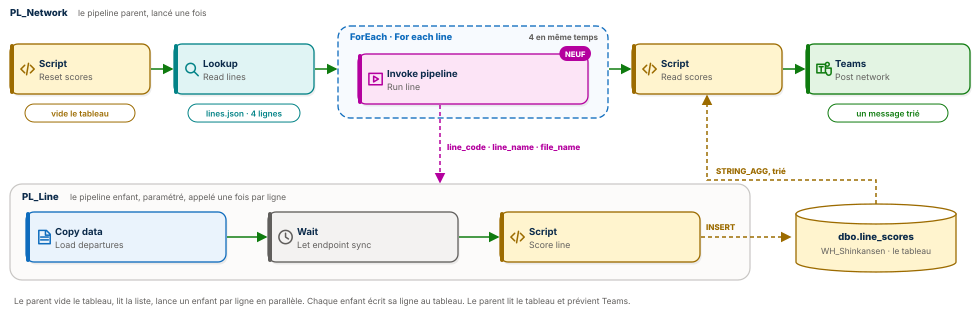
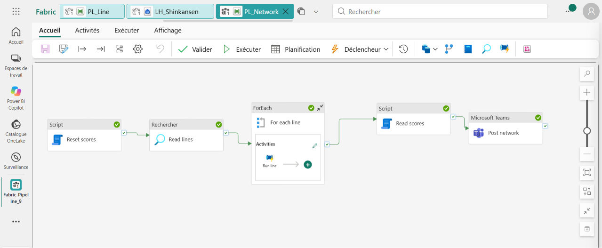
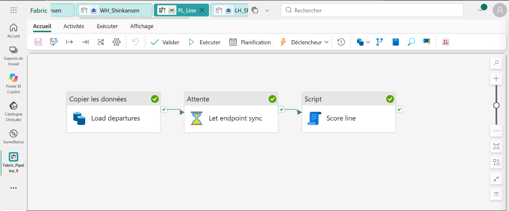
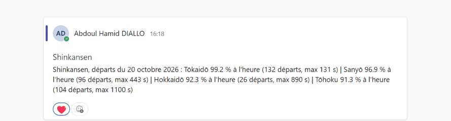
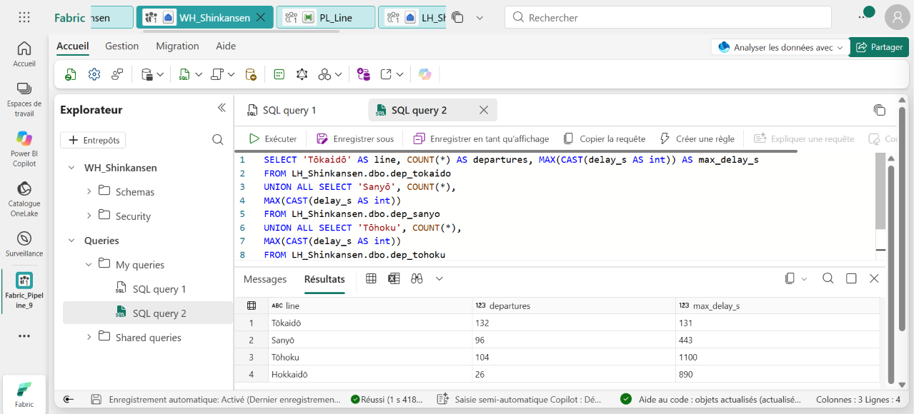

# 🚄 Fabric Pipeline Express 9 : un parent, un enfant, quatre lignes de Shinkansen




Un pipeline Microsoft Fabric Data Factory qui mesure la ponctualité de quatre lignes de Shinkansen au Japon. Un pipeline parent lit la liste des lignes dans un fichier JSON et lance, pour chacune et en même temps, un pipeline enfant paramétré. Chaque enfant charge les départs de sa ligne, calcule sa ponctualité depuis l'entrepôt et inscrit son verdict dans une table partagée. Le parent lit cette table et annonce le classement du réseau dans Microsoft Teams.

**Guide PDF de 7 pages inclus** : [`Pipeline_Fabric_Guide_9_public.pdf`](Pipeline_Fabric_Guide_9_public.pdf). Chaque activité, chaque champ, chaque expression, et les chiffres à retrouver à l'unité près. Les valeurs à copier sont dans [`data/expressions.txt`](data/expressions.txt) et les requêtes commentées dans [`sql/`](sql).

## 📸 Aperçu

`PL_Network`, le pipeline parent, après une exécution réussie : il vide le tableau, lit la liste des lignes, lance l'enfant pour chaque ligne dans un ForEach, lit le tableau et prévient Teams.



`PL_Line`, le pipeline enfant : il charge le CSV de sa ligne, laisse au point de terminaison SQL le temps de voir la nouvelle table, puis mesure et écrit son verdict.



L'annonce publiée dans Microsoft Teams : les quatre lignes, classées de la plus ponctuelle à la moins ponctuelle.



La requête de contrôle lancée dans l'entrepôt `WH_Shinkansen`, qui lit les quatre tables du lakehouse par leur nom à trois parties.



## 🎯 Résultats clés

| Indicateur | Valeur |
|---|---|
| Pipelines | 2 : `PL_Network` (parent) et `PL_Line` (enfant) |
| Activités | 9 (Script ×3, Lookup, ForEach, Invoke pipeline, Copy data, Wait, Microsoft Teams) |
| Nouveautés | Orchestration parent et enfant, paramètres de pipeline, liste pilotée par un fichier JSON, requête interbases du Warehouse vers le Lakehouse |
| Enfants lancés en parallèle | 4, à la même seconde |
| Départs analysés | 358 (132 + 96 + 104 + 26) |
| Ponctualité du réseau | 95,8 % (343 départs sur 358 avec moins d'une minute de retard) |
| Ligne la plus ponctuelle | Tōkaidō, 99,2 % : un seul départ en retard sur 132 |
| Pire retard | 1 100 s sur Tōhoku, soit 18 min 20 s |
| Ligne écrite en dur dans les pipelines | 0 |

## 💼 Impact métier

Chaque ligne envoie ses départs dans son propre fichier. Un pipeline qui connaît les lignes par cœur doit être modifié à chaque ouverture ou fermeture de ligne, et il grossit avec le réseau. Ici, la liste vit dans `lines.json` : ajouter la ligne Kyūshū demain, c'est une entrée de plus dans le fichier et un CSV de plus dans le dossier, sans ouvrir un seul pipeline. Les quatre lignes sont traitées en même temps, et l'équipe d'exploitation reçoit chaque jour un classement trié qui met en évidence la ligne à surveiller.

## 📝 Résumé

`PL_Network` commence par vider la table `line_scores` de l'entrepôt. Un Lookup lit `Files/config/lines.json` et renvoie les quatre lignes. Un ForEach, en mode parallèle avec un lot de 4, lance `PL_Line` pour chacune avec Invoke pipeline, en lui passant trois paramètres : le code, le nom et le fichier de la ligne. Dans chaque enfant, un Copy data charge `Files/inbox/<fichier>` dans la table Delta `dep_<code>`, un Wait de 90 secondes laisse le point de terminaison SQL synchroniser la nouvelle table, puis un Script exécuté sur `WH_Shinkansen` lit `LH_Shinkansen.dbo.dep_<code>`, calcule la ponctualité et insère une phrase verdict. Quand les quatre enfants ont terminé, un Script assemble le tableau avec `STRING_AGG` trié, et Teams publie le classement.

## 🔁 Pipelines

**`PL_Network`**, le parent

| Activité | Type | Rôle |
|---|---|---|
| `Reset scores` | Script | `DELETE FROM dbo.line_scores` : le tableau ne garde que la dernière exécution |
| `Read lines` | Lookup | `Files/config/lines.json`, format JSON, première ligne uniquement décochée |
| `For each line` | ForEach | `@activity('Read lines').output.value`, séquentiel décoché, lot de 4 |
| `Run line` | Invoke pipeline | Lance `PL_Line`, attend la fin, paramètres `@item().code`, `@item().name`, `@item().file` |
| `Read scores` | Script | `STRING_AGG(summary, ' \| ') WITHIN GROUP (ORDER BY on_time_pct DESC)` |
| `Post network` | Microsoft Teams | Publie le classement du réseau |

**`PL_Line`**, l'enfant, avec trois paramètres : `line_code`, `line_name`, `file_name`

| Activité | Type | Rôle |
|---|---|---|
| `Load departures` | Copy data | `Files/inbox/@{pipeline().parameters.file_name}` vers `dep_@{pipeline().parameters.line_code}`, action Remplacer |
| `Let endpoint sync` | Wait | 90 secondes |
| `Score line` | Script | Calcule la ponctualité et insère le verdict dans `dbo.line_scores` |

## 🧠 Les quatre idées du projet

**L'enfant ne sait rien d'avance.** Trois paramètres le rendent universel : il traite n'importe quelle ligne qu'on lui confie. On le teste seul, ligne par ligne, avant de le brancher au parent.

**Le fichier pilote.** Les pipelines ne contiennent aucun nom de ligne. Le Lookup lit `lines.json`, et le ForEach crée autant d'itérations qu'il y a d'entrées.

**Le tableau relie les deux.** Invoke pipeline rend au parent le statut de l'enfant. Les données, elles, passent par une table partagée de l'entrepôt : chaque enfant y insère sa ligne, le parent la lit à la fin. C'est simple, sûr en parallèle et vérifiable en SQL.

**Le warehouse lit le lakehouse.** Le Script s'exécute sur `WH_Shinkansen` et lit `LH_Shinkansen.dbo.dep_tokaido` par son nom à trois parties, sans copier la donnée. Le lakehouse stocke, l'entrepôt calcule et écrit.

## 🚦 Le pipeline en une image

| Étape | Dans une gare | Dans Fabric |
|---|---|---|
| 1 | La feuille de service dit quelles lignes contrôler | `lines.json`, lu par un Lookup |
| 2 | Le chef de gare efface le tableau et envoie un contrôleur par ligne | `PL_Network` : Script, ForEach, Invoke pipeline |
| 3 | Chaque contrôleur relève sa ligne et écrit son verdict au tableau | `PL_Line` : Copy data, Wait, Script |
| 4 | Le chef de gare lit le tableau, du plus ponctuel au moins ponctuel | Script `Read scores` avec `STRING_AGG` |
| 5 | L'annonce passe dans la gare | Microsoft Teams |

## 🧬 Traçabilité

```
LH_Shinkansen / Files / config / lines.json ──▶ Lookup Read lines : 4 lignes
                                                     │
                       ForEach For each line (parallèle, lot de 4)
                                                     │  Invoke pipeline Run line × 4
                                                     ▼
PL_Line (line_code, line_name, file_name)
   Files/inbox/departures_tokaido_2026-10-20.csv  ──▶ Copy data ──▶ dep_tokaido    132 départs
   Files/inbox/departures_sanyo_2026-10-20.csv    ──▶ Copy data ──▶ dep_sanyo       96 départs
   Files/inbox/departures_tohoku_2026-10-20.csv   ──▶ Copy data ──▶ dep_tohoku     104 départs
   Files/inbox/departures_hokkaido_2026-10-20.csv ──▶ Copy data ──▶ dep_hokkaido    26 départs
                                                     │  Wait 90 s
                                                     ▼
Script Score line sur WH_Shinkansen ──▶ INSERT dans dbo.line_scores : 4 verdicts
                                                     ▼
Script Read scores (STRING_AGG trié) ──▶ Microsoft Teams Post network
   « Shinkansen, départs du 20 octobre 2026 : Tōkaidō 99.2 % à l'heure (132 départs, max 131 s)
     | Sanyō 96.9 % … | Hokkaidō 92.3 % … | Tōhoku 91.3 % à l'heure (104 départs, max 1100 s) »
```

## 🏗️ Architecture

| Objet Fabric | Type | Rôle |
|---|---|---|
| `LH_Shinkansen` | Lakehouse | Reçoit les CSV dans `Files/inbox` et la liste dans `Files/config`, porte les quatre tables `dep_<code>` |
| `WH_Shinkansen` | Entrepôt | Exécute les scripts, lit le lakehouse en requête interbases, porte `dbo.line_scores` |
| `PL_Line` | Pipeline | L'enfant paramétré : charge, attend, mesure une ligne |
| `PL_Network` | Pipeline | Le parent : vide, lit la liste, lance les enfants, lit le tableau, prévient |

Le cœur du calcul, exécuté une fois par ligne :

```sql
INSERT INTO dbo.line_scores
SELECT '@{pipeline().parameters.line_code}',
       CAST(100.0 * SUM(CASE WHEN CAST(delay_s AS int) < 60 THEN 1 ELSE 0 END) / COUNT(*) AS decimal(5,1)),
       CONCAT('@{pipeline().parameters.line_name} ',
              CAST(100.0 * SUM(CASE WHEN CAST(delay_s AS int) < 60 THEN 1 ELSE 0 END) / COUNT(*) AS decimal(5,1)),
              ' % à l''heure (', COUNT(*), ' départs, max ', MAX(CAST(delay_s AS int)), ' s)')
FROM LH_Shinkansen.dbo.dep_@{pipeline().parameters.line_code};
```

Un train est à l'heure s'il part avec moins de 60 secondes de retard. La part de ces trains donne le pourcentage, et `CONCAT` écrit la phrase que Teams publiera. Les paramètres du pipeline choisissent la table lue et le nom affiché.

## 📊 Résultat final

```sql
SELECT * FROM dbo.line_scores ORDER BY on_time_pct DESC;
```

| Ligne | Trajet | Départs | À l'heure | Retard moyen | Pire retard |
|---|---|---|---|---|---|
| **Tōkaidō** | Tokyo, Shin-Osaka | 132 | **99,2 %** | 11,8 s | 131 s |
| Sanyō | Shin-Osaka, Hakata | 96 | 96,9 % | 22,8 s | 443 s |
| Hokkaidō | Shin-Aomori, Shin-Hakodate-Hokuto | 26 | 92,3 % | 50,0 s | 890 s |
| Tōhoku | Tokyo, Shin-Aomori | 104 | 91,3 % | 38,4 s | **1 100 s** |

## 📦 Jeu de données

```
data/
├── inbox/
│   ├── departures_tokaido_2026-10-20.csv    132 départs
│   ├── departures_sanyo_2026-10-20.csv       96 départs
│   ├── departures_tohoku_2026-10-20.csv     104 départs
│   └── departures_hokkaido_2026-10-20.csv    26 départs
├── config/
│   └── lines.json                           la liste des lignes qui pilote le parent
└── expressions.txt                          toutes les valeurs du guide, prêtes à copier
```

Six champs par départ : `train_id`, `train_type` (Nozomi, Hikari, Kodama, Mizuho, Sakura, Hayabusa, Hayate, Yamabiko, Nasuno), `origin`, `destination`, `sched_dep` et `delay_s`, le retard au départ en secondes. Données fictives, conçues pour l'exercice et reproductibles avec [`tools/generate_dataset.py`](tools/generate_dataset.py) ; [`tools/expected_results.py`](tools/expected_results.py) recalcule les verdicts attendus.

## 🚀 Reproduire l'exercice

1. Créer un lakehouse `LH_Shinkansen`, y déposer les CSV dans `Files/inbox` et `lines.json` dans `Files/config`.
2. Créer un entrepôt `WH_Shinkansen` et y exécuter [`sql/01_create_line_scores.sql`](sql/01_create_line_scores.sql).
3. Créer `PL_Line` avec ses trois paramètres, puis Copy data, Wait et Script [`sql/03_score_line.sql`](sql/03_score_line.sql). Le tester seul avec les valeurs par défaut.
4. Créer `PL_Network` : Script [`sql/02_reset_scores.sql`](sql/02_reset_scores.sql), Lookup, ForEach contenant Invoke pipeline, Script [`sql/04_read_scores.sql`](sql/04_read_scores.sql), Teams.
5. Exécuter `PL_Network`, lire le classement dans Teams, contrôler avec [`sql/05_controle.sql`](sql/05_controle.sql).

## 📂 Structure du dépôt

```
fabric-pipeline-express-9/
├── README.md
├── Pipeline_Fabric_Guide_9_public.pdf   le guide de 7 pages
├── data/                                les départs, la liste des lignes et les expressions
├── sql/
│   ├── 01_create_line_scores.sql        crée le tableau dans l'entrepôt
│   ├── 02_reset_scores.sql              vide le tableau (parent)
│   ├── 03_score_line.sql                mesure une ligne (enfant)
│   ├── 04_read_scores.sql               assemble le classement (parent)
│   └── 05_controle.sql                  contrôle des quatre tables
├── tools/
│   ├── generate_dataset.py              régénère les CSV et lines.json
│   └── expected_results.py              recalcule les verdicts attendus
└── images/
    ├── pipeline_diagram.svg             le schéma parent et enfant
    ├── pipeline_network.png             PL_Network après une exécution réussie
    ├── pipeline_line.png                PL_Line après une exécution réussie
    ├── teams_message.png                le classement dans Microsoft Teams
    └── sql_results.png                  la requête de contrôle dans WH_Shinkansen
```

## 🧰 Stack technique

Microsoft Fabric Data Factory · Invoke pipeline · Paramètres de pipeline · ForEach parallèle · Lookup JSON · Copy data · Wait · Script · Lakehouse et Delta · Warehouse et T-SQL · Requête interbases · Microsoft Teams

## ✅ Conclusion

Quatre lignes aujourd'hui, cinq demain, dix l'an prochain : le pipeline ne bouge pas. Le parent orchestre, l'enfant exécute, un fichier décide du périmètre et une table partagée rassemble les verdicts. Neuf activités, deux pipelines réutilisables, et un classement trié qui arrive chaque jour dans Teams.

## 💭 Dernier mot

Un bon pipeline ne connaît pas ses données par cœur. Il sait déléguer, et il sait écouter ce qu'on lui rapporte.

---

Abdoul Hamid Diallo · Microsoft Data & AI Engineer · Microsoft Certified DP-600, DP-700, PL-300, AI-102, DP-100, AI-900, DP-900 · [LinkedIn](https://www.linkedin.com/in/abdoul-hamid-diallo-fabric-data-engineer/)
